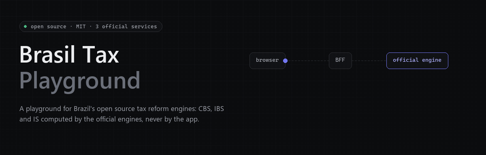
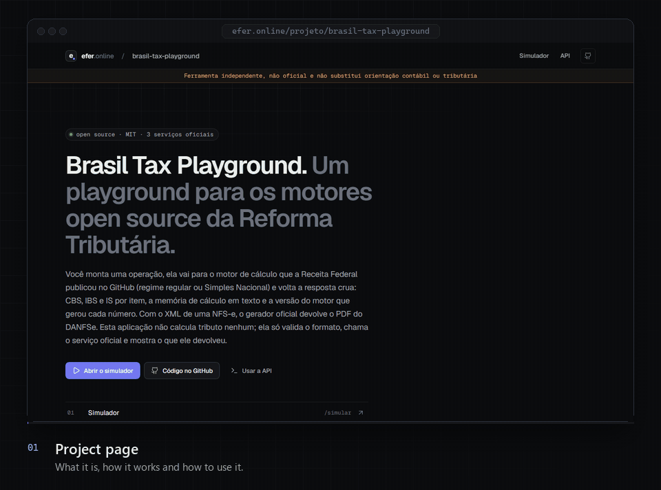
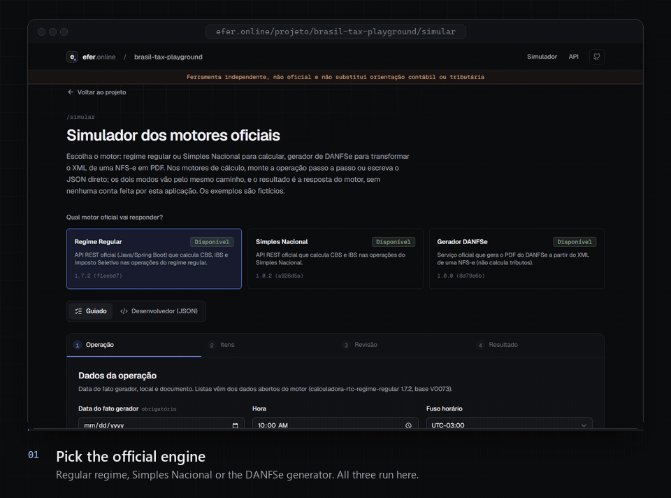
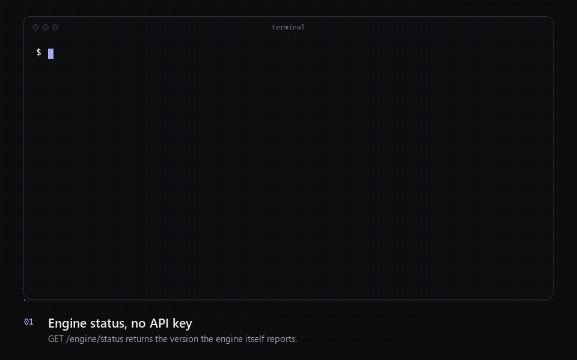
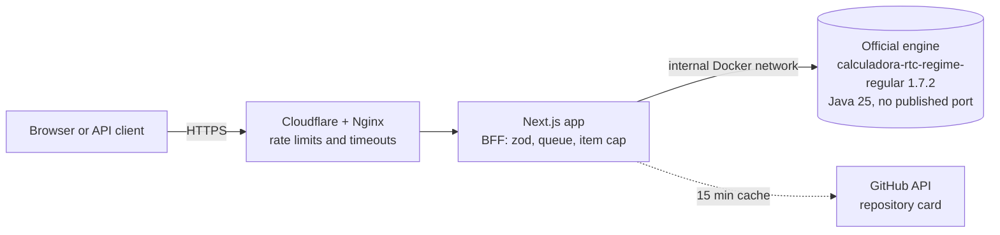

<div align="center">

<a href="https://efer.online/projeto/brasil-tax-playground"></a>

<p>
<a href="https://github.com/Efer-Eder/brasil-tax-playground/actions/workflows/ci.yml"></a>
<a href="https://efer.online/projeto/brasil-tax-playground"></a>
<a href="https://github.com/ReceitaFederal/calculadora-rtc-regime-regular"></a>
<a href="LICENSE"></a>
<a href="https://github.com/Efer-Eder/brasil-tax-playground/commits/main"></a>
</p>

<p>
<a href="https://efer.online/projeto/brasil-tax-playground"><b>Project page</b></a>
&nbsp;·&nbsp;
<a href="https://efer.online/projeto/brasil-tax-playground/simular"><b>Simulator</b></a>
&nbsp;·&nbsp;
<a href="#public-api"><b>API</b></a>
&nbsp;·&nbsp;
<a href="README.md"><b>Português</b></a>
</p>

</div>

> [!IMPORTANT]
> Independent, unofficial tool. It does not replace accounting or tax advice and has no affiliation with Brazil's Federal Revenue Service (Receita Federal). **Work in progress**. The guided form and local history are in the code; the public instance gets this version on the next deploy. The UI is in Brazilian Portuguese.

## Why this exists

In 2026 Receita Federal published the calculation engines of Brazil's consumption tax reform on GitHub (CBS, IBS and the Selective Tax, IS). They are Java APIs meant to run on your own machine, with no UI. This project puts an interface and a public API in front of the official engine, so you can **study and test how it behaves** without setting everything up from scratch.

The one rule behind everything: **no tax rate, rule or calculation is written here**. The app validates the shape, calls the engine and shows the raw response, with the calculation trail and the engine version that produced each number. If the engine is down, the UI says so; there is no fallback simulator.

<div align="center">

</div>

## What you can do

| | |
|---|---|
| **Guided mode** | Five steps built from the contract the engine publishes: state and city, CST and cClassTrib from the table in force on the date, and NCM or NBS looked up in the engine itself. No tax value is prefilled. |
| **Developer mode** | JSON editor in the engine's `OperacaoInput` shape, fictitious examples, file import, validate, format and copy. Both modes use the same path to the engine. |
| **See the engine's answer** | Per-item state, errors with the field path, the calculation trail as text and the item values. |
| **Inspect and export** | Tables labeled with the engine's own field descriptions, raw request and response side by side, JSON and CSV export, and local history (browser only). |
| **Use the public API** | No sign-up, no key, open CORS, measured limits. |
| **Follow the project** | Live GitHub card on the page: commits, issues, PRs, contributors and the latest CI run. |

<div align="center">

</div>

## Public API

Base URL: `https://efer.online/api/brasil-tax-playground`

<div align="center">

</div>

```bash
# Engine status and version
curl https://efer.online/api/brasil-tax-playground/engine/status

# A fictitious 2026 operation (before 2027 the engine rejects aliquotasNominais)
curl -X POST https://efer.online/api/brasil-tax-playground/simular/regime-regular \
  -H 'Content-Type: application/json' \
  -d '{"id":"test","versao":"1.0.0","dhFatoGerador":"2026-06-01T10:00:00-03:00",
       "municipio":4314902,"uf":"RS",
       "itens":[{"numero":1,"ncm":"22030000","cst":"000","cClassTrib":"000001","baseCalculo":100}]}'
```

| Method | Route | Returns |
|---|---|---|
| `GET` | `/engine/status` | Engine state and version (app, database and database date). |
| `POST` | `/simular/regime-regular` | The request, the raw engine response, its version and `x-warning-dados-simulados`. |
| `GET` | `/github` | Repository summary used by the page's GitHub card. |

<details>
<summary><b>Limits and response codes</b></summary>

<br>

Limits come from load tests on the server (about 30 req/s with 1 item and 6 req/s with 50 items). Full math in [docs/deploy-efer-online.md](docs/deploy-efer-online.md) (Portuguese).

| Limit | Value |
|---|---|
| Per client | 2 req/s, burst of 20 |
| Whole instance | 30 req/s |
| Items per operation | 50 |
| Body | 512 KB |
| Concurrent engine calls | 3, queue of 32 (3 s max wait) |
| Engine timeout | 8 s |

| Code | When |
|---|---|
| `200` | Computed. Per-item errors come in `objetos[].estadoItem`, as in the engine. |
| `400` | Invalid JSON. |
| `413` | More than 50 items or a body over 512 KB. |
| `422` | Failed structural validation; the response lists each problem's path. |
| `429` | Rate limited. Honor `Retry-After`. |
| `502` | The engine rejected it (ProblemDetail passed through as is) or broke the contract. |
| `503` | Queue full or engine down. |
| `504` | The engine did not answer within 8 s. |

</details>

## How it works



- **Numbers only from the engine.** No tax rate, reduction or rule in the code.
- **Mirrored contract.** Schemas copy the Bean Validation of the upstream input classes, with a link to the commit. Business rules stay in the engine.
- **Tested against the real thing.** Parity with the upstream's own 102 test payloads (69 identical responses, 10 identical errors, 23 rejected by both), fixtures recorded from the engine, UI parity and a regression test that fails if upstream output changes. Report in [DEVELOPMENT_REPORT.md](DEVELOPMENT_REPORT.md).

## Run it locally

Requirements: Node.js 20.9+ (tested with Node 24). For the engine: Java 25.

```bash
git clone https://github.com/Efer-Eder/brasil-tax-playground.git
cd brasil-tax-playground
npm ci
npm run dev
```

Open http://localhost:3000. Without an engine, the panel shows **Não configurado** (not configured) and no simulation runs. That is expected.

<details>
<summary><b>Run the official engine locally (Windows)</b></summary>

<br>

```powershell
# outside the app folder
git -c core.longpaths=true clone --branch 1.7.2 https://github.com/ReceitaFederal/calculadora-rtc-regime-regular.git
cd calculadora-rtc-regime-regular
$env:JAVA_HOME = "C:\path\to\jdk-25"
mkdir calculadora\db
.\mvnw.cmd flyway:migrate "-Dflyway.configFiles=flyway\flyway-pro.conf" --batch-mode --errors
.\mvnw.cmd spring-boot:run "-Dspring-boot.run.profiles=offline"
```

In the app's `.env.local`:

```env
REGIME_REGULAR_ENGINE_URL=http://localhost:8080/api
```

Step by step, contracts and gotchas: [docs/upstream-integration.md](docs/upstream-integration.md) (Portuguese).

</details>

<details>
<summary><b>Scripts</b></summary>

<br>

| Command | What it does |
|---|---|
| `npm run dev` | Development server |
| `npm run build` / `npm start` | Standalone build and run |
| `npm run lint` | ESLint |
| `npm run typecheck` | Next route types + `tsc --noEmit` |
| `npm test` | Unit tests (Vitest) |
| `npm run test:e2e` | Playwright against a server that only replays recorded engine responses (run `npm run build` first) |
| `npm run test:contract` | Contract (OpenAPI) and regression tests against a real engine (`CONTRACT_ENGINE_URL`) |
| `npm run test:paridade` | Compares the app with the engine on the upstream test payloads (`CONTRACT_ENGINE_URL` + `UPSTREAM_TESTS_DIR`) |
| `npm run fixtures:gravar` | Re-record fixtures from a real engine (`CONTRACT_ENGINE_URL` + `RECORD_FIXTURES=1`) |

</details>

## Tests and CI

- **Unit (Vitest):** validation, engine errors, queue, cache and the GitHub card.
- **Parity:** the UI is rendered from recorded real engine responses and compared value by value.
- **Regression:** optional, against a running engine; fails if upstream output changes.
- **End to end (Playwright):** against a replay server, never calling GitHub or the real engine.
- **CI:** Ubuntu and Windows, E2E and secret scanning with gitleaks.

## Official engines

| Repository | Status here |
|---|---|
| [calculadora-rtc-regime-regular](https://github.com/ReceitaFederal/calculadora-rtc-regime-regular) | Integrated (1.7.2) |
| [calculadora-rtc-simples-nacional](https://github.com/ReceitaFederal/calculadora-rtc-simples-nacional) | Planned |
| [calculadora-rtc-gerador-danfse](https://github.com/ReceitaFederal/calculadora-rtc-gerador-danfse) | Planned (renders a PDF from XML; does not calculate taxes) |

## Contributing

Issues, PRs and stars help. Read [CONTRIBUTING.md](CONTRIBUTING.md) first; the one non-negotiable rule is that **no tax number goes into the code**, it comes from the engine. Code of conduct in [CODE_OF_CONDUCT.md](CODE_OF_CONDUCT.md); security issues in [SECURITY.md](SECURITY.md).

## License

[MIT](LICENSE) © Efer Eder. The official engines have their own license (MIT) and copyright holder (Receita Federal do Brasil) and are not redistributed here.

<div align="center">
<sub>The GIFs in this README are generated from real screens of the public instance by <code>scripts/readme/</code>.</sub>
</div>
