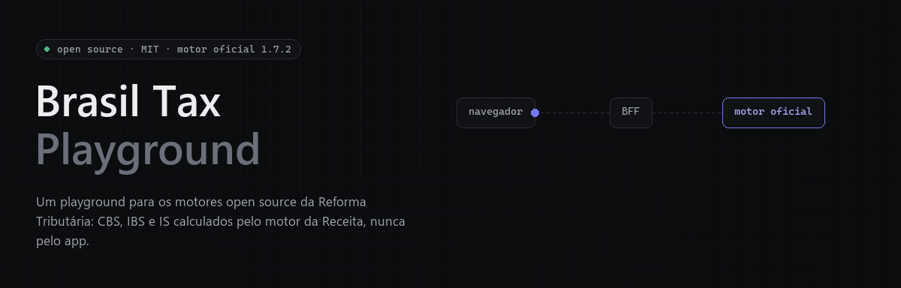
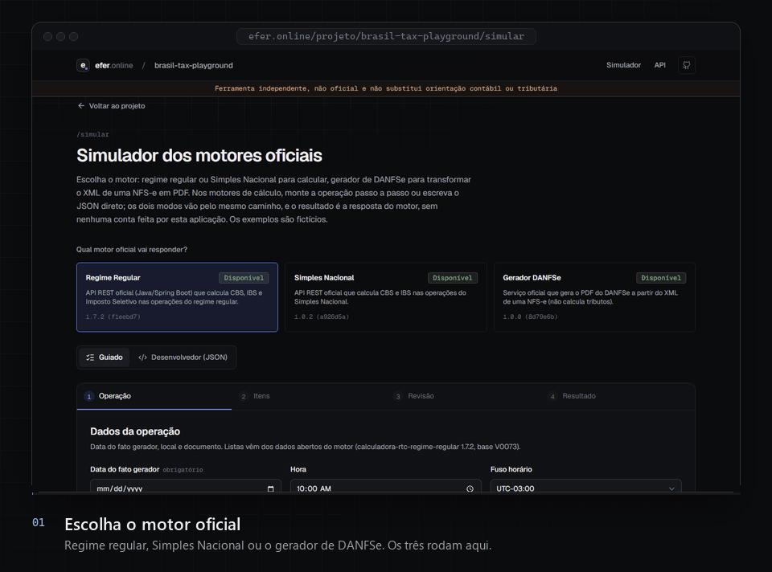
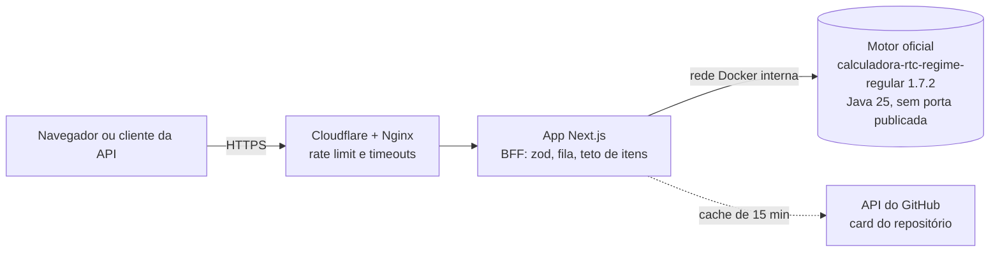

<div align="center">

<a href="https://efer.online/projeto/brasil-tax-playground"></a>

<p>
<a href="https://github.com/Efer-Eder/brasil-tax-playground/actions/workflows/ci.yml"></a>
<a href="https://efer.online/projeto/brasil-tax-playground"></a>
<a href="https://github.com/ReceitaFederal/calculadora-rtc-regime-regular"></a>
<a href="LICENSE"></a>
<a href="https://github.com/Efer-Eder/brasil-tax-playground/commits/main"></a>
</p>

<p>
<a href="https://efer.online/projeto/brasil-tax-playground"><b>Página do projeto</b></a>
&nbsp;·&nbsp;
<a href="https://efer.online/projeto/brasil-tax-playground/simular"><b>Simulador</b></a>
&nbsp;·&nbsp;
<a href="#api-pública"><b>API</b></a>
&nbsp;·&nbsp;
<a href="README.en.md"><b>English</b></a>
</p>

</div>

> [!IMPORTANT]
> Ferramenta independente, não oficial e não substitui orientação contábil ou tributária. Sem vínculo com a Receita Federal. Projeto **em desenvolvimento**: hoje a entrada é um editor JSON; o formulário guiado vem depois.

## Por que isso existe

Em 2026 a Receita Federal publicou no GitHub os motores de cálculo da Reforma Tributária do Consumo (CBS, IBS e Imposto Seletivo). São APIs Java para rodar na sua máquina, sem tela nenhuma. Este projeto coloca uma interface e uma API pública na frente do motor oficial, para quem quer **estudar e testar como ele se comporta** sem montar o ambiente do zero.

A regra que guia tudo: **nenhuma alíquota, regra ou cálculo fiscal é escrito aqui**. O app valida o formato, chama o motor e mostra a resposta crua, com a memória de cálculo e a versão do motor que gerou cada número. Se o motor cair, a tela diz que caiu; não existe simulador alternativo.

<div align="center">

</div>

## O que dá para fazer

| | |
|---|---|
| **Simular uma operação** | Editor JSON no formato `OperacaoInput` do motor, com exemplos fictícios prontos. |
| **Ver a resposta do motor** | Estado de cada item, erros com o caminho do campo, memória de cálculo em texto e valores do item. |
| **Inspecionar e exportar** | Requisição e resposta cruas lado a lado e download da simulação em JSON. |
| **Usar a API pública** | Sem cadastro, sem chave, CORS aberto, limites medidos. |
| **Acompanhar o projeto** | Card ao vivo do GitHub na página: commits, issues, PRs, contribuidores e último CI. |

<div align="center">

</div>

## API pública

Base: `https://efer.online/api/brasil-tax-playground`

<div align="center">

</div>

```bash
# Estado do motor e versão
curl https://efer.online/api/brasil-tax-playground/engine/status

# Uma operação fictícia de 2026 (antes de 2027 o motor não aceita aliquotasNominais)
curl -X POST https://efer.online/api/brasil-tax-playground/simular/regime-regular \
  -H 'Content-Type: application/json' \
  -d '{"id":"teste","versao":"1.0.0","dhFatoGerador":"2026-06-01T10:00:00-03:00",
       "municipio":4314902,"uf":"RS",
       "itens":[{"numero":1,"ncm":"22030000","cst":"000","cClassTrib":"000001","baseCalculo":100}]}'
```

| Método | Rota | O que devolve |
|---|---|---|
| `GET` | `/engine/status` | Estado do motor e versão (app, base de dados e data da base). |
| `POST` | `/simular/regime-regular` | Requisição, resposta crua do motor, versão e `x-warning-dados-simulados`. |
| `GET` | `/github` | Resumo do repositório usado pelo card da página. |

<details>
<summary><b>Limites e códigos de resposta</b></summary>

<br>

Os limites saíram de teste de carga no servidor (cerca de 30 req/s com 1 item e 6 req/s com 50 itens). Contas completas em [docs/deploy-efer-online.md](docs/deploy-efer-online.md).

| Limite | Valor |
|---|---|
| Por cliente | 2 req/s, rajada de 20 |
| Total da instância | 30 req/s |
| Itens por operação | 50 |
| Corpo | 512 KB |
| Chamadas simultâneas ao motor | 3, com fila de 32 (espera máxima de 3 s) |
| Timeout do motor | 8 s |

| Código | Quando |
|---|---|
| `200` | Cálculo feito. Erro por item vem em `objetos[].estadoItem`, como no motor. |
| `400` | JSON inválido. |
| `413` | Mais de 50 itens ou corpo acima de 512 KB. |
| `422` | Falhou na validação estrutural; a resposta traz o caminho de cada problema. |
| `429` | Rate limit. Respeite o `Retry-After`. |
| `502` | O motor recusou (ProblemDetail repassado como veio) ou respondeu fora do contrato. |
| `503` | Fila cheia ou motor fora do ar. |
| `504` | O motor não respondeu em 8 s. |

</details>

## Como funciona



- **Número só do motor.** Nenhuma alíquota, redução ou regra no código.
- **Contrato espelhado.** Os schemas copiam a Bean Validation das classes de entrada do upstream, com link para o commit. Regra de negócio fica com o motor.
- **Testado contra o real.** Fixtures gravadas do motor de verdade, teste de paridade entre resposta e tela, e regressão que falha se o upstream mudar a saída.

## Rodar na sua máquina

Requisitos: Node.js 20.9+ (testado com Node 24). Para o motor: Java 25.

```bash
git clone https://github.com/Efer-Eder/brasil-tax-playground.git
cd brasil-tax-playground
npm ci
npm run dev
```

Abra http://localhost:3000. Sem motor configurado, o painel mostra **Não configurado** e nenhuma simulação roda. É o comportamento esperado.

<details>
<summary><b>Subir o motor oficial localmente (Windows)</b></summary>

<br>

```powershell
# fora da pasta do app
git -c core.longpaths=true clone --branch 1.7.2 https://github.com/ReceitaFederal/calculadora-rtc-regime-regular.git
cd calculadora-rtc-regime-regular
$env:JAVA_HOME = "C:\caminho\para\jdk-25"
mkdir calculadora\db
.\mvnw.cmd flyway:migrate "-Dflyway.configFiles=flyway\flyway-pro.conf" --batch-mode --errors
.\mvnw.cmd spring-boot:run "-Dspring-boot.run.profiles=offline"
```

No `.env.local` do app:

```env
REGIME_REGULAR_ENGINE_URL=http://localhost:8080/api
```

Passo a passo, contratos e armadilhas: [docs/upstream-integration.md](docs/upstream-integration.md).

</details>

<details>
<summary><b>Scripts</b></summary>

<br>

| Comando | O que faz |
|---|---|
| `npm run dev` | Servidor de desenvolvimento |
| `npm run build` / `npm start` | Build standalone e execução |
| `npm run lint` | ESLint |
| `npm run typecheck` | Tipos de rotas do Next + `tsc --noEmit` |
| `npm test` | Testes unitários (Vitest) |
| `npm run test:e2e` | Playwright, com um servidor que só reproduz respostas gravadas do motor (rode `npm run build` antes) |
| `npm run test:contract` | Contrato e regressão contra um motor real (`CONTRACT_ENGINE_URL`) |
| `npm run fixtures:gravar` | Regrava as fixtures a partir de um motor real (`CONTRACT_ENGINE_URL` + `RECORD_FIXTURES=1`) |

</details>

## Testes e CI

- **Unitários (Vitest):** validação, erros do motor, fila, cache e o card do GitHub.
- **Paridade:** a tela é renderizada a partir de respostas gravadas do motor real e comparada valor a valor.
- **Regressão:** opcional, contra um motor rodando; falha se o upstream mudar a saída.
- **Ponta a ponta (Playwright):** contra um servidor de replay, sem chamar o GitHub nem o motor de verdade.
- **CI:** Ubuntu e Windows, E2E e varredura de segredos com gitleaks.

## Motores oficiais

| Repositório | Estado aqui |
|---|---|
| [calculadora-rtc-regime-regular](https://github.com/ReceitaFederal/calculadora-rtc-regime-regular) | Integrado (1.7.2) |
| [calculadora-rtc-simples-nacional](https://github.com/ReceitaFederal/calculadora-rtc-simples-nacional) | Planejado |
| [calculadora-rtc-gerador-danfse](https://github.com/ReceitaFederal/calculadora-rtc-gerador-danfse) | Planejado (gera PDF a partir de XML; não calcula tributos) |

## Documentação

- [Integração com os motores oficiais](docs/upstream-integration.md)
- [Instância pública: arquitetura, medições e limites](docs/deploy-efer-online.md)
- [Notas de conformidade](docs/compliance-notes.md)
- [Decisões de arquitetura (ADRs)](docs/adr/)
- [Progresso](PROGRESS.md) · [Roadmap](ROADMAP.md) · [Changelog](CHANGELOG.md)

## Contribuir

Issue, PR e estrela ajudam. Antes, leia o [CONTRIBUTING.md](CONTRIBUTING.md); a única regra inegociável é que **nenhum número fiscal entra no código**, ele vem do motor. Código de conduta em [CODE_OF_CONDUCT.md](CODE_OF_CONDUCT.md); problemas de segurança em [SECURITY.md](SECURITY.md).

## Licença

[MIT](LICENSE) © Efer Eder. Os motores oficiais têm licença (MIT) e titular próprios (Receita Federal do Brasil) e não são distribuídos aqui.

<div align="center">
<sub>Os GIFs deste README são gerados a partir de telas reais da instância pública por <code>scripts/readme/</code>.</sub>
</div>
